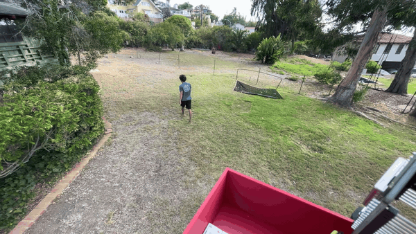
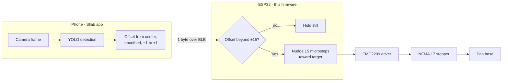
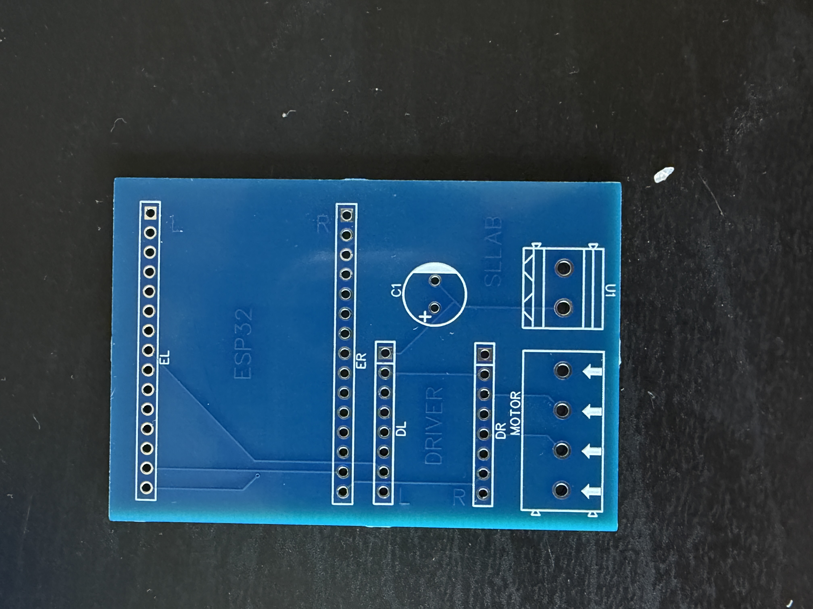
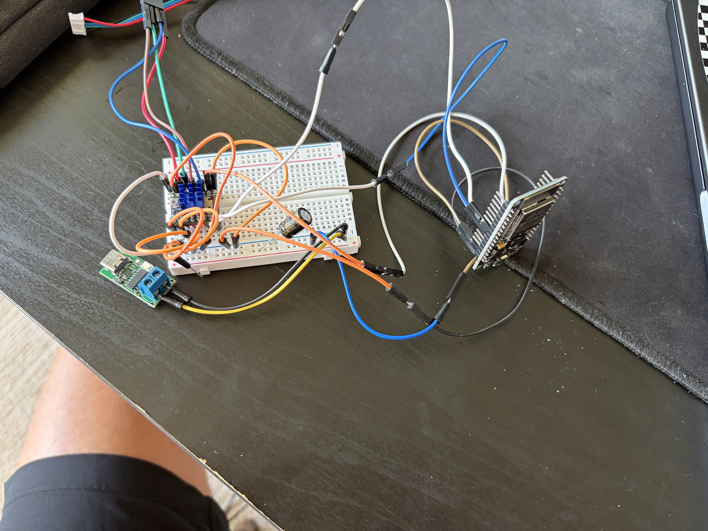
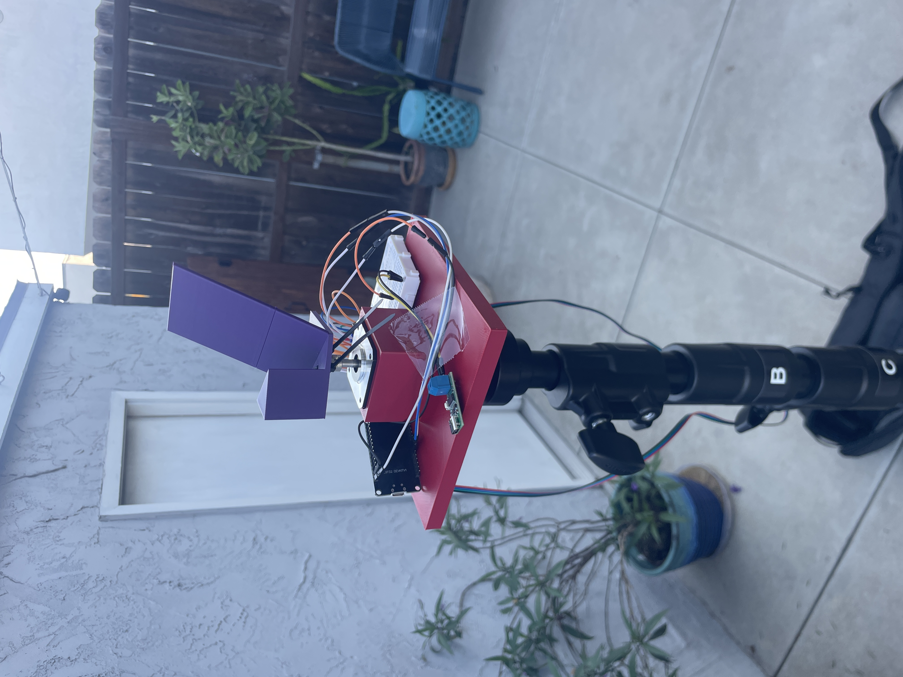
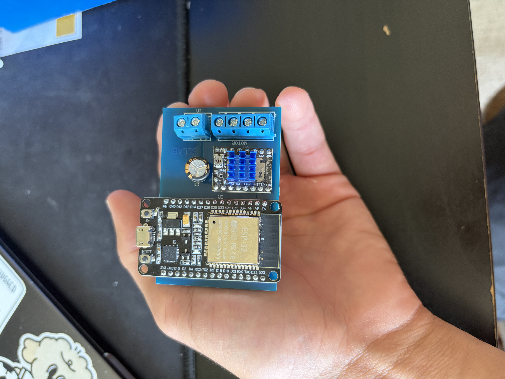
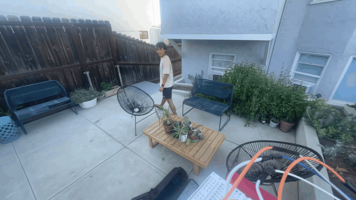

# Sllab Hardware

Firmware, PCB and 3D-printable parts for [Video by SLLAB](https://github.com/luciusscala/sllab) auto-tracking camera mount for soccer game film: a stepper-driven pan base that turns an iPhone into an automated cameraman, steered over Bluetooth.

It's part of [Sllab](https://sllab.io), a platform that makes team operations, film and stats affordable for club sports. The full film system costs about $400, compared to about $2,000 for commercial auto-tracking setups.

> **Status:** working prototype. The full tracking loop (detect → smooth → Bluetooth → motor) runs end to end using person detection. A ball-specific model is in progress in the [app repo](https://github.com/luciusscala/sllab).

## How it works

- **One byte per command.** The phone writes a single signed byte with write-without-response, so commands are fast and nothing waits on an acknowledgement.
- **Latest command wins.** The BLE callback only stores the newest offset. If commands arrive while the motor is mid-move, stale ones are dropped instead of queued, so the mount never chases where the target *was*.
- **Deadzone.** Offsets within ±15 (about 12% of full scale) are ignored, so the camera holds steady when the target is roughly centered instead of hunting back and forth.
- **Small, quiet moves.** The driver runs at 1/8 microstepping, so each 15-microstep nudge turns the mount about 3.4°. The TMC2209's silent mode keeps motor noise off the film's audio.
- **Auto-reconnect.** The ESP32 re-advertises as soon as the phone disconnects.

## Hardware

| Part | Role |
|---|---|
| ESP32 dev board (30-pin) | Controller and Bluetooth |
| BIGTREETECH TMC2209 V1.3 | Stepper driver, standalone STEP/DIR mode |
| STEPPERONLINE NEMA 17 (1.8°, 1.5 A, 42 N·cm) | Pan motor, 200 steps/rev |
| 12 V power bank | Power |
| Custom PCB | Carrier board (below) |
| 3D-printed parts | Base housing, shaft coupler, phone holder |

PCB components with LCSC part numbers are in [`pcb/bom.csv`](pcb/bom.csv).

### PCB

The Sllab Video Mount Controller: a two-layer, all through-hole carrier board (about 45 × 65 mm) designed in EasyEDA. The ESP32 and the driver plug into header sockets, so either can be swapped without soldering.

- **Power:** 12 V in through a screw terminal, with a 100 µF bulk capacitor to absorb current spikes when the motor steps. The same rail feeds the driver's motor supply and the ESP32's VIN.
- **Logic:** the ESP32's 3.3 V output powers the driver's logic side (VIO), so STEP/DIR signals are at the right level.
- **Control:** STEP on GPIO 25, DIR on GPIO 26.
- **Driver config:** EN, MS1 and MS2 are tied to ground, so the driver is always enabled at 1/8 microstepping.
- **Motor:** 4-pin screw terminal (A1, A2, B1, B2).

| File | What it is |
|---|---|
| [`pcb/schematic.pdf`](pcb/schematic.pdf) | Schematic |
| [`pcb/bom.csv`](pcb/bom.csv) | Board components |
| [`pcb/fabrication/gerbers.zip`](pcb/fabrication/gerbers.zip) | Gerbers and drill files, ready to order from JLCPCB, PCBWay or similar |
| [`pcb/source/`](pcb/source) | Editable EasyEDA files (File → Open → EasyEDA, then select the `.json`) |

### 3D-printed parts

| File | Part |
|---|---|
| [`cad/base-housing.stl`](cad/base-housing.stl) | Base enclosure that holds the stepper motor |
| [`cad/shaft-coupler.stl`](cad/shaft-coupler.stl) | Couples the motor shaft to the phone holder |
| [`cad/phone-holder.stl`](cad/phone-holder.stl) | Phone cradle |

GitHub renders the `.stl` files as interactive 3D previews. To assemble: press-fit the shaft coupler onto the stepper shaft, seat the motor in the base housing, and attach the phone holder to the coupler.

## Firmware

**Requirements:** the Arduino IDE (or arduino-cli) with the ESP32 board package.

1. Open `firmware/soccercam/soccercam.ino`.
2. Select your ESP32 board and port, then upload.
3. Open the serial monitor at 115200 baud. You should see `BLE ready. Advertising as 'SoccerCam'.`
4. Launch the Sllab app; it scans for the service UUID and connects automatically.

The service and characteristic UUIDs must match `BluetoothManager.swift` in the app.

**Tuning** (top of the sketch):

| Constant | Default | Effect |
|---|---|---|
| `STEPS_PER_NUDGE` | 15 | Microsteps per move (15 ≈ 3.4°); higher = bigger jumps |
| `PULSE_DELAY_US` | 5000 | Step pulse timing; higher = slower, smoother moves |
| `DEADZONE` | 15 | How far off-center (of ±127) before the mount moves |

## Development

Prototyped end to end, from a breadboard to a custom PCB with 3D-printed parts. The enclosure and PCB were refined with a mechanical engineer and a systems engineer.

| 1. Breadboard | 2. First print | 3. Custom PCB | 4. Tracking |
|---|---|---|---|
|  |  |  |  |
| ESP32, driver and motor wired by hand | Printed base and phone holder on a stand | Assembled board with ESP32 and TMC2209 | First tracking test |

**Ideas for the next revision**
- Route the driver's EN pin to a GPIO so the firmware can switch the motor off when idle, to run cooler and save battery.
- Add a buck converter so the ESP32 gets 5 V instead of 12 V on VIN.
- Scale move size with the offset, so the mount turns faster when play is far off-center.

## Repository layout

| Folder | Contents |
|---|---|
| `firmware/soccercam/` | ESP32 firmware (Arduino) |
| `pcb/` | Schematic, BOM, Gerbers, EasyEDA source |
| `cad/` | 3D-printable parts (`.stl`) |
| `media/timeline/` | Build photos and tracking demos |

## Related repos

| Repo | What it is |
|---|---|
| [sllab](https://github.com/luciusscala/sllab) | iOS film app: on-device detection, steering, YouTube upload |
| [sllab.io](https://github.com/luciusscala/sllab.io) | Sllab project site |

## AI Disclosure

Parts of this codebase and readme were written with the help of AI. All files were reviewed by a human, but it is provided as-is, with no guarantee that it is correct, secure, or fit for any particular purpose.
